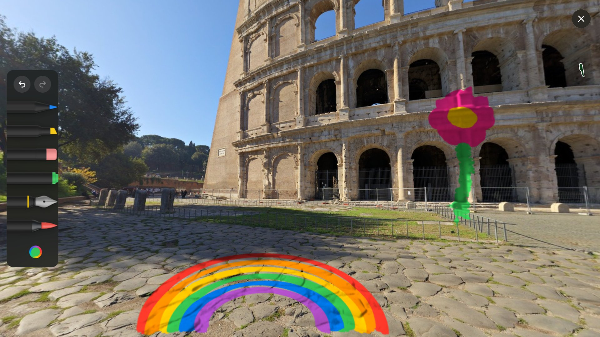

# paintaround.com

Draw on the world’s walls, together. [paintaround.com](https://paintaround.com) is a map of 360° photos
you can step into and paint on. Everyone in a place sees everyone else's strokes as they're drawn.



- **Paint that belongs there.** Strokes wrap onto the surfaces in the photo, around corners and over
  cobblestones, and take on its light and shadow. Each place has a depth map and a lighting map for this.
- **Live.** The others' brushes run in your browser on the same samples, so you watch their strokes
  grow exactly as they do.
- **Nothing to sign up for.** No accounts and no database: drawings live in the server's memory.
- **Moderated.** Finished drawings are checked by a vision model, with an undo for its mistakes.

Pencil, marker, crayon, fountain pen, watercolor and eraser. On phones one finger paints and two look
around; on a computer the right button looks around.

## Run it

You need Node 24.

```sh
npm install
npm run photos       # downloads a few places (the photos aren't in the repository)
npm run server       # the drawing server, in one terminal
npm run dev          # the site, in another: http://localhost:5173
```

Strokes are flat until a place has 3D data: see [docs/3d-data.md](docs/3d-data.md).
The server's settings (moderation, alerts) are in [.env.example](.env.example);
`node --env-file=.env server/realtime.ts` uses them.

## Work on it

```sh
npm run lint
npm run typecheck
npm test              # the drawing server, moderation and the map's clustering
npm run test:browser  # the real app in Chrome; needs photos (and 3D data for most)
```

[docs/architecture.md](docs/architecture.md) explains how it works and where things are.

## License

The code is under the [GNU AGPL 3.0](LICENSE): if you run a changed version for others, share your
changes. These are not covered by it:

- The photos, which come from [Poly Haven](https://polyhaven.com) (CC0) and Wikimedia Commons. Each
  one's author and license are in `src/data/panorama-pool.json`.
- The textures in `public/textures`, by David Revoy (CC0).
