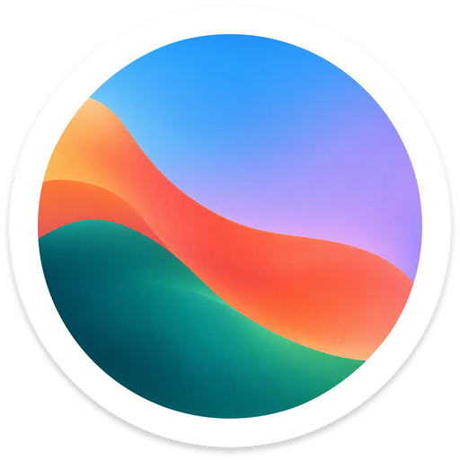
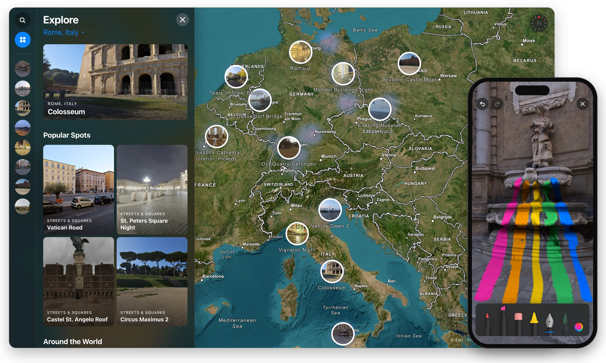
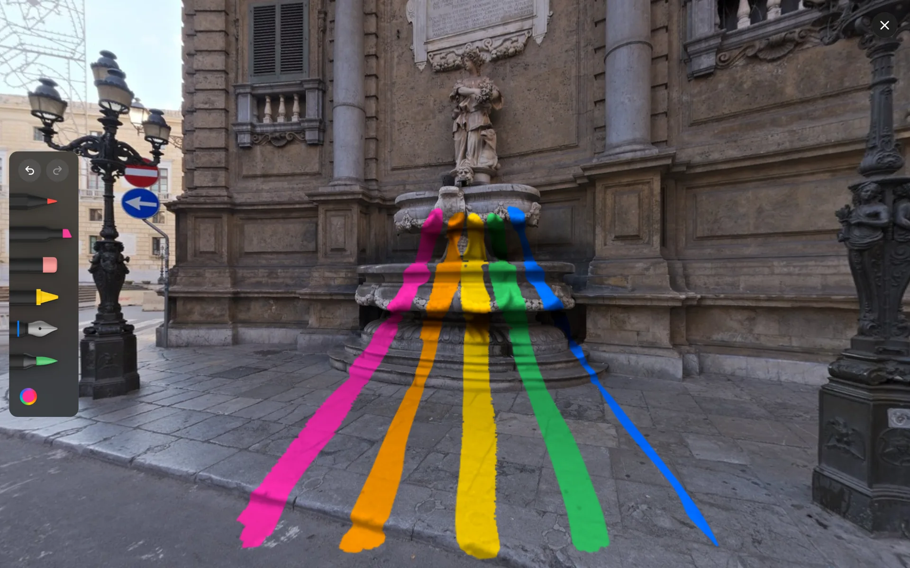

<p align="center">
  <a href="https://paintaround.com"></a>
</p>

<h1 align="center">paintaround.com</h1>

<p align="center">
  Draw on real places in 360°, together, live.<br>
  <a href="https://paintaround.com"><b>Try it</b></a> · <a href="docs/architecture.md">How it works</a> · <a href="#run-it">Run it</a>
</p>

<p align="center">
  <a href="https://github.com/mrktsm/paintaround.com/actions"></a>
  <a href="https://github.com/mrktsm/paintaround.com/actions"></a>
  <a href="https://paintaround.com"></a>
  <a href="LICENSE"></a>
  <a href="https://github.com/mrktsm/paintaround.com/stargazers"></a>
</p>

<p align="center">
  <a href="https://paintaround.com"></a>
</p>

paintaround.com is a map of 360° photos you can step into and paint on. Everyone in a place sees everyone
else's strokes as they're drawn.

## Features

- **Paint that belongs there:** strokes wrap onto the surfaces in the photo, around corners and over
  cobblestones, and take on its light and shadow.
- **Live:** others' brushes run in your browser on the same samples, so you watch their strokes grow exactly
  as they do.
- **200 places:** zoom the map from whole countries into single squares, or search.
- **Six tools:** pencil, marker, crayon, fountain pen, watercolor and an eraser, with undo.
- **Nothing to sign up for:** no accounts and no database. Drawings live in the server's memory.
- **Moderated:** finished drawings are checked by a vision model, and its mistakes can be undone.
- **On your phone:** one finger paints, two look around. It installs like an app.

<p align="center">
  
</p>

## How it works

Each place has a depth map and a lighting map, made once. Where you draw, the surface around your stroke is
unfolded into a flat sheet, the brush paints on that sheet, and a shader folds it back onto the photo, lit
like everything around it. [Read more](docs/architecture.md), or see
[how the 3D data is made](pipeline/3d/README.md).

## Tech stack

- **Client:** React, TypeScript, Vite, WebGL, [MapLibre](https://maplibre.org) for the map,
  [mapillary-js](https://github.com/mapillary/mapillary-js) for the 360° view
- **Server:** Node, WebSockets, [sharp](https://sharp.pixelplumbing.com)
- **3D data:** [DA360](https://github.com/Insta360-Research-Team/DA360) for depth,
  [Marigold](https://huggingface.co/prs-eth/marigold-iid-lighting-v1-1) for lighting
- **CI/CD:** GitHub Actions: checks on every push, and what reaches `main` goes live

## Run it

You need Node 24.

```sh
npm install
npm run photos       # downloads a few places (the photos aren't in the repository)
npm run server       # the drawing server, in one terminal
npm run dev          # the site, in another: http://localhost:5173
```

Strokes are flat until a place has [3D data](pipeline/3d/README.md). The server's settings (moderation,
alerts) are in [.env.example](.env.example); `node --env-file=.env server/realtime.ts` uses them.

## Work on it

```
client/     the website
server/     the live drawing server
shared/     what both use
pipeline/   adding places: choosing photos, making 3D data
scripts/    getting the photos, deploying
tests/
```

```sh
npm run lint
npm run typecheck
npm test              # the drawing server, moderation and the map's clustering
npm run test:browser  # the real app in Chrome; needs photos (and 3D data for most)
```

## License

The code is under the [GNU AGPL 3.0](LICENSE): if you run a changed version for others, share your
changes. These are not covered by it:

- The photos, which come from [Poly Haven](https://polyhaven.com) (CC0) and Wikimedia Commons. Each
  one's author and license are in `client/src/data/panorama-pool.json`.
- The textures in `client/public/textures`, by David Revoy (CC0).
- The map imagery in the picture above: Esri, Vantor, Earthstar Geographics, TomTom, Garmin, FAO, NOAA, USGS
  and the GIS User Community, © OpenStreetMap contributors.
