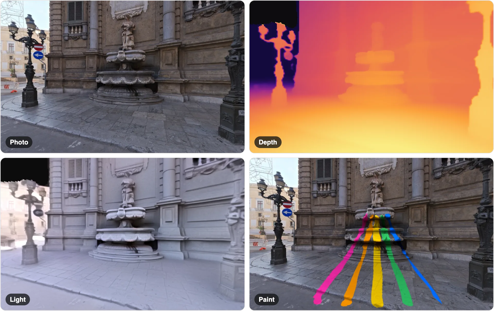

#  paintaround.com

[](https://github.com/mrktsm/paintaround.com/actions)
[](https://github.com/mrktsm/paintaround.com/actions)
[](LICENSE)

Draw on 360° photos of real places, together with whoever else is there.

[**Try it live**](https://paintaround.com) · [How it works](#how-it-works) · [Run it](#run-it)

[](https://paintaround.com)

## Features

- Strokes follow the surfaces in the photo and are shaded by its light
- Other people's strokes and cursors show up live
- 200 places on a map, with search
- Pencil, marker, crayon, fountain pen, watercolor, eraser, undo and redo
- No accounts and no database: drawings are kept in the server's memory until it restarts
- Finished drawings are checked by a vision model
- Works on phones (one finger draws, two look around) and can be installed as a PWA

## How it works

Each place has a precomputed depth map and lighting map. When you draw, the surface around the stroke is
unwrapped into a 2D sheet using the depth map. The brush paints on the sheet, and a shader maps it back onto
the photo and multiplies it by the lighting map.



<sub>Top: photo, depth map. Bottom: lighting map, paint using both.</sub>

More in [docs/architecture.md](docs/architecture.md) and [pipeline/3d](pipeline/3d/README.md).

## Tech stack

- **Client:** React, TypeScript, Vite, WebGL, [MapLibre](https://maplibre.org) for the map,
  [mapillary-js](https://github.com/mapillary/mapillary-js) for the 360° view
- **Server:** Node, WebSockets, [sharp](https://sharp.pixelplumbing.com)
- **3D data:** [DA360](https://github.com/Insta360-Research-Team/DA360) for depth,
  [Marigold](https://huggingface.co/prs-eth/marigold-iid-lighting-v1-1) for lighting
- **CI/CD:** GitHub Actions runs the checks on every push and deploys `main`

## Run it

You need Node 24.

```sh
npm install
npm run photos       # downloads a few places (the photos aren't in the repository)
npm run server       # the drawing server, in one terminal
npm run dev          # the site, in another: http://localhost:5173
```

Strokes are flat until a place has [3D data](pipeline/3d/README.md). The server's settings (moderation,
alerts) are in [.env.example](.env.example); `node --env-file=.env server/realtime.ts` uses them.

## Development

```
client/     the website
server/     the live drawing server
shared/     what both use
pipeline/   adding places: choosing photos, making 3D data
scripts/    getting the photos, deploying
tests/
```

```sh
npm run lint
npm run typecheck
npm test              # the drawing server, moderation and the map's clustering
npm run test:browser  # the real app in Chrome; needs photos (and 3D data for most)
```

## License

The code is under the [MIT license](LICENSE). These are not covered by it:

- The photos, which come from [Poly Haven](https://polyhaven.com) (CC0) and Wikimedia Commons. Each
  one's author and license are in `shared/panorama-pool.json`.
- The textures in `client/public/textures`, by David Revoy (CC0).
